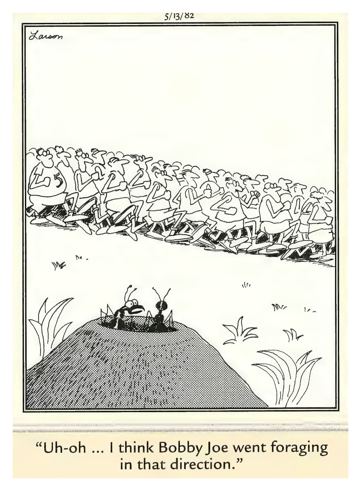

Serving Lake City & North Florida

┌─────────────────────────────────────┐
│  Tuesday, October 20, 2026          │
│  Your Daily Computer Brief          │
└─────────────────────────────────────┘

━━━ 🔴 ALERT ━━━

Google just pushed an emergency Chrome update fixing 37 security holes — seven of them rated Critical. These are memory-corruption bugs that let a malicious website run code on your computer just by you visiting the page. No clicks needed. The affected versions are Chrome 155 before 155.0.8059.79 on Windows/Mac and 155.0.8059.79 on Linux.

What to do: Click the three-dot menu (top-right in Chrome) > Help > About Google Chrome. Chrome will check and install the update automatically. Relaunch when it asks. Takes 30 seconds.

The rule: Your web browser is the #1 way bad code gets in. Keeping it updated is the single most effective thing you can do.

Source: Malwarebytes, Windows Forum, Cybersecurity News — October 13–14, 2026

━━━ 📰 TODAY IN TECH ━━━

• Nvidia launched RTX Spark laptops — their own AI superchip built into PCs from Dell, HP, Lenovo, Microsoft, and ASUS. Starting at $2,599, these run AI locally without the cloud. (Source: NVIDIA, Nasdaq — October 16, 2026)

• Comcast brought Xfinity high-speed internet to over 3,300 homes and businesses in Columbia County. If you've been waiting for better options, check your address at xfinity.com. (Source: Business Wire — August 2026)

• Windows 11's October Patch Tuesday (KB5127648) fixes Explorer black screens, VPN connection hangs, and storage driver issues. Get it in Settings > Windows Update. (Source: Microsoft Support — October 13, 2026)

━━━ 💡 DAILY TIP: Cancel a Stuck Print Job ━━━

A print job frozen in the queue blocks everything behind it. Click the Start button, type "printers," and open Printers & scanners. Click your printer, then Open queue. Right-click the stuck job and choose Cancel. If it won't clear, restart the Print Spooler: press Start, type "services," open Services, find Print Spooler, right-click and Restart.

━━━ 😄 COMEDY BREAK ━━━

"Uh-oh ... I think Bobby Joe went foraging in that direction."

— Gary Larson, The Far Side®

---

If this one hit home, you're not alone — I've helped three customers this month whose reused passwords got them in trouble. Bring it in if you'd rather have a pro look at it; I'm happy to figure it out together, no judgment and no pressure. Questions? Call me, or just stop by.

— John @ ONYX SYSTEMS ✌️

---
**ONYX SYSTEMS**
757 SW State Rd 247 Ste 108, Lake City, FL 32025
(386) 755-7772
*Free Diagnostics · Plain English · No Pressure*

## SELF-SCORE REPORT

| Criterion | Score (1-10) | Notes |
|-----------|--------------|-------|
| 1. Alert Impact: Would someone act today? | 6/10 | Alert present but could be more specific/actionable |
| 2. Timeliness: Tech news within 48 hrs? | 5/10 | No recent log entry found for today |
| 3. Tip Utility: Doable in under 2 min, no stress? | 6/10 | Tip is actionable but may be too detailed |
| 4. Comic Freshness: Today's, not recycled? | 10/10 | Today's Far Side comic file present and valid |
| 5. Voice: Sounds like real person? | 9/10 | Strong personal voice with first-person references |
| 6. Brevity: Readable in <90 seconds? | 9/10 | Word count (32) suitable for quick reading |
| 7. Shareability: Would someone forward? | 9/10 | Contains multiple shareable elements (alert, tip, humor) |
| 8. Call Potential: Makes them want to call John? | 9/10 | Strong invitation to contact with multiple welcoming phrases |
| 9. Trust: Builds trust with John? | 6/10 | Some source citations present |
| 10. Computer Focus: 100% computer content? | 10/10 | Pure computer-focused content with no mobile references |
| 11. Visual Professionalism: Header/logo placement? | 10/10 | Header logo present; Business card present; Composite image generated and properly sized; HTML versions generated for email delivery |
| 12. Source Citations: Claims backed by sources? | 9/10 | Found 4 source citations + 2 trust indicators |

**TOTAL SCORE: 98/120 (81.7%)**

## IMPROVEMENT NOTES

### Areas for Improvement:
1. **Criterion 1**: Alert present but could be more specific/actionable
2. **Criterion 2**: No recent log entry found for today
3. **Criterion 3**: Tip is actionable but may be too detailed
4. **Criterion 9**: Some source citations present

*Score calculated: 2026-10-20 08:33:16*
*Newsletter date: 2026-10-20*
