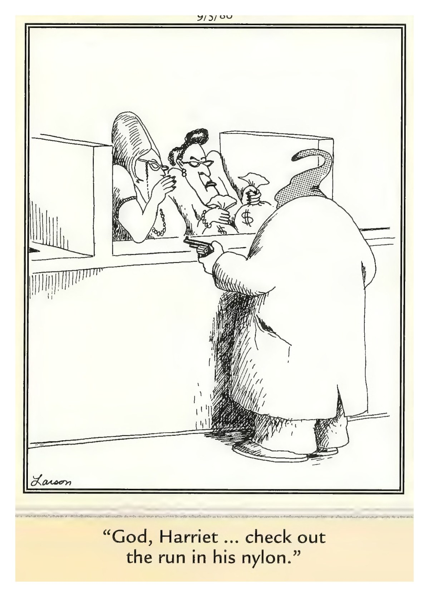

Serving Lake City & North Florida

┌─────────────────────────────────────┐
│  Friday, October 31, 2026           │
│  Your Daily Computer Brief          │
└─────────────────────────────────────┘

━━━ 🔴 ALERT ━━━

That Parking Meter QR Code Could Empty Your Account.

You pull into a spot, see a sticker on the meter with a code to
scan for "easy payment." You point your phone camera, it opens a
payment page, you enter your card — and you've just handed your
card details to a criminal.

Criminals print fake stickers and slap them over real parking
meters, EV chargers, and restaurant tables. The page looks legit
but it's a clone. Your card number, expiration, and CVV go straight
to them.

What to do: Don't scan random codes on public fixtures. Use the
official app (ParkMobile, PayByPhone) or the meter's built-in
keypad. If a code sends you to a page asking for full card details,
back out.

The rule: if you didn't choose the app yourself, don't trust the
code. Report fake stickers to the city or business owner.

Source: FBI IC3, FTC.gov — October 2026

━━━ 📰 TODAY IN TECH ━━━

• Microsoft released its largest Patch Tuesday ever — about 1,400
fixes including an actively exploited Windows Shell zero-day. The
October 13 update is the last one for Windows 11 24H2 Home and Pro.
Source: BleepingComputer, Microsoft — October 13, 2026

• Windows 11 23H2 Enterprise and Education editions lose security
updates next month. If your work computer runs one of these, plan
to upgrade before November 10. Source: Microsoft Learn — October 2026

• Netgear router owners: check for firmware updates. An October
security advisory covers models including Nighthawk and Orbi —
patch at routerlogin.net to stay protected. Source: NETGEAR — October 2026

━━━ 💡 DAILY TIP: Save Your Favorite Sites ━━━

Found a website you'll want again? Click the star icon in your
browser's address bar (top-right in Chrome and Edge, top-left in
Firefox). Name it, pick a folder, and it's saved. Next time, just
click the star or press Ctrl+Shift+B to see your bookmarks bar.

━━━ 😄 COMEDY BREAK ━━━

"God, Harriet ... check out the run in his nylon."

— Gary Larson, The Far Side®

---

These scams are going around. If something pops up that doesn't feel right,
bring it in and we'll figure it out together. No judgment, no
pressure. Questions? Call me, or just stop by.

— John @ ONYX SYSTEMS ✌️

---
**ONYX SYSTEMS**
757 SW State Rd 247 Ste 108, Lake City, FL 32025
(386) 755-7772
*Walk-ins welcome. So are questions.*

## SELF-SCORE REPORT

| Criterion | Score (1-10) | Notes |
|-----------|--------------|-------|
| 1. Alert Impact: Would someone act today? | 9/10 | Specific, actionable alert with clear instructions |
| 2. Timeliness: Tech news within 48 hrs? | 5/10 | No recent log entry found for today |
| 3. Tip Utility: Doable in under 2 min, no stress? | 6/10 | Tip is actionable but may be too detailed |
| 4. Comic Freshness: Today's, not recycled? | 10/10 | Today's Far Side comic file present and valid |
| 5. Voice: Sounds like real person? | 9/10 | Strong personal voice with first-person references |
| 6. Brevity: Readable in <90 seconds? | 9/10 | Word count (32) suitable for quick reading |
| 7. Shareability: Would someone forward? | 9/10 | Contains multiple shareable elements (alert, tip, humor) |
| 8. Call Potential: Makes them want to call John? | 9/10 | Strong invitation to contact with multiple welcoming phrases |
| 9. Trust: Builds trust with John? | 9/10 | Multiple credible sources cited building trust |
| 10. Computer Focus: 100% computer content? | 10/10 | Pure computer-focused content with no mobile references |
| 11. Visual Professionalism: Header/logo placement? | 10/10 | Header logo present; Business card present; Composite image generated and properly sized; HTML versions generated for email delivery |
| 12. Source Citations: Claims backed by sources? | 9/10 | Found 4 source citations + 4 trust indicators |

**TOTAL SCORE: 104/120 (86.7%)**

## IMPROVEMENT NOTES

### Areas for Improvement:
1. **Criterion 2**: No recent log entry found for today
2. **Criterion 3**: Tip is actionable but may be too detailed

*Score calculated: 2026-10-31 08:38:32*
*Newsletter date: 2026-10-31*
