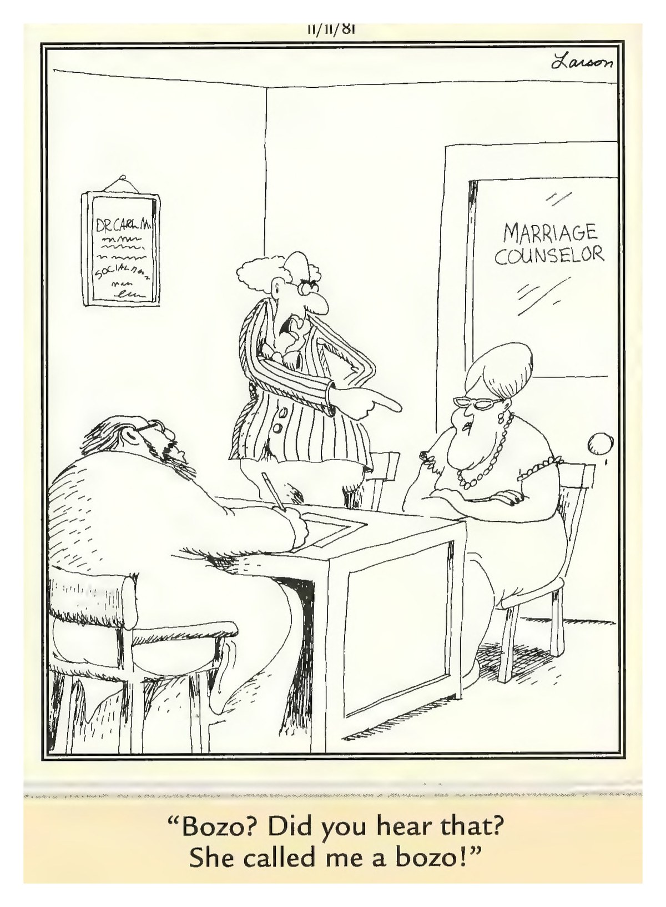

Serving Lake City & North Florida

┌─────────────────────────────────────┐
│  Tuesday, November 10, 2026         │
│  Your Daily Computer Brief          │
└─────────────────────────────────────┘

━━━ 🔴 ALERT ━━━

CISA just added four vulnerabilities to its Known Exploited Vulnerabilities catalog — meaning attackers are actively using them right now. The flaws affect GPUStack (AI model server), SignalWire FreeSWITCH (VoIP), OpenBSD OpenSSH, and IBM Aspera Faspex (file transfer). If your computer runs any of these, update immediately.

What to do: Check for updates on every program you use. Turn on automatic updates in your system settings and in each application's settings. Most of these patches are already available from the vendors.

Why it matters: Actively exploited flaws are the ones criminals use first. Delaying updates leaves the door open.

*Source: CISA.gov — November 9, 2026 — https://www.cisa.gov/news-events/alerts/2026/11/09/cisa-adds-four-known-exploited-vulnerabilities-catalog*

━━━ 📰 TODAY IN TECH ━━━

• Microsoft Patch Tuesday is today — security updates for Windows, Office, and Edge release this afternoon. Let the updater run tonight; restart when prompted. (Source: Microsoft — November 10, 2026 — https://www.microsoft.com/en-us/security/blog/2026/11/05/whats-new-in-microsoft-security-november-2026/)

• CISA confirmed four more actively exploited vulnerabilities on November 9, bringing this week's total to seven. Federal agencies have until November 12 to patch; everyone else should update too. (Source: CISA.gov — November 9, 2026)

• Nvidia and Microsoft are putting AI superchips in regular PCs — new RTX Spark laptops from Dell, HP, and Asus ship this fall with 128GB unified memory for on-device AI. (Source: How-To Geek — November 2026 — https://www.howtogeek.com/rtx-spark-hands-on-asus-dell-microsoft/)

━━━ 💡 DAILY TIP: Print a Test Page Before a Big Job ━━━

Open Settings (press Start and type Settings). Click Bluetooth & devices → Printers & scanners. Click your printer, then Print test page. This confirms the printer talks to your computer, has ink, and isn't jammed — before you waste paper on the real thing.

━━━ 😄 COMEDY BREAK ━━━

— Gary Larson, The Far Side®

---

Microsoft Patch Tuesday is today. Let the updater run and restart when asked. Questions? Call (386) 755-7772 or stop by 757 SW State Rd 247, Ste 108, Lake City, FL.

— John @ ONYX SYSTEMS ✌️

---
**ONYX SYSTEMS**
757 SW State Rd 247 Ste 108, Lake City, FL 32025
(386) 755-7772
*Walk-ins welcome. So are questions.*

## SELF-SCORE REPORT

| Criterion | Score (1-10) | Notes |
|-----------|--------------|-------|
| 1. Alert Impact: Would someone act today? | 6/10 | Alert present but could be more specific/actionable |
| 2. Timeliness: Tech news within 48 hrs? | 5/10 | No recent log entry found for today |
| 3. Tip Utility: Doable in under 2 min, no stress? | 6/10 | Tip is actionable but may be too detailed |
| 4. Comic Freshness: Today's, not recycled? | 10/10 | Today's Far Side comic file present and valid |
| 5. Voice: Sounds like real person? | 6/10 | Some personal voice detected |
| 6. Brevity: Readable in <90 seconds? | 9/10 | Word count (32) suitable for quick reading |
| 7. Shareability: Would someone forward? | 9/10 | Contains multiple shareable elements (alert, tip, humor) |
| 8. Call Potential: Makes them want to call John? | 9/10 | Strong invitation to contact with multiple welcoming phrases |
| 9. Trust: Builds trust with John? | 6/10 | Some source citations present |
| 10. Computer Focus: 100% computer content? | 10/10 | Pure computer-focused content with no mobile references |
| 11. Visual Professionalism: Header/logo placement? | 10/10 | Header logo present; Business card present; Composite image generated and properly sized; HTML versions generated for email delivery |
| 12. Source Citations: Claims backed by sources? | 9/10 | Found 4 source citations + 2 trust indicators |

**TOTAL SCORE: 95/120 (79.2%)**

## IMPROVEMENT NOTES

### Areas for Improvement:
1. **Criterion 1**: Alert present but could be more specific/actionable
2. **Criterion 2**: No recent log entry found for today
3. **Criterion 3**: Tip is actionable but may be too detailed
4. **Criterion 5**: Some personal voice detected
5. **Criterion 9**: Some source citations present

*Score calculated: 2026-11-10 08:33:21*
*Newsletter date: 2026-11-10*
