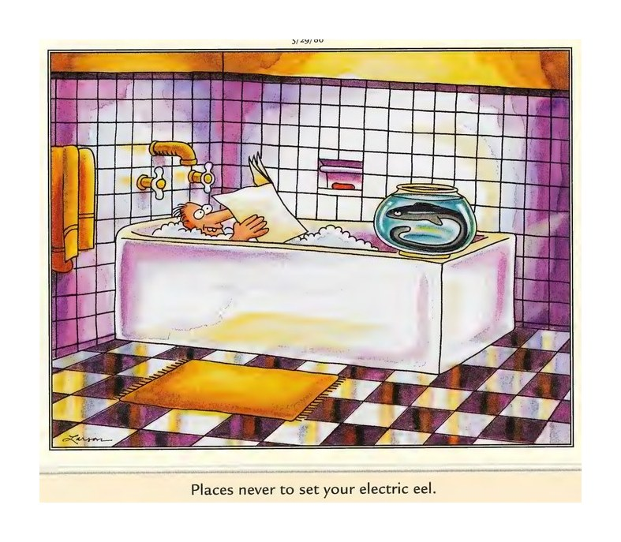

**Serving Lake City & North Florida**

┌─────────────────────────────────────┐
│  Saturday, November 28, 2026        │
│  Your Daily Computer Brief          │
└─────────────────────────────────────┘

━━━ 🔴 ALERT ━━━

Scammers are pretending to be the Federal Trade Commission. They send emails and make phone calls claiming to be from the FTC, using fake badge numbers and official-looking logos. Some even spoof the FTC's real phone number on your caller ID. The real FTC will never call, email, or text you to demand money, threaten arrest, or ask for payment by gift card, wire transfer, or cryptocurrency. If someone claims to be from the FTC and pressures you to pay or share personal information, it's a scam. Hang up or delete the message. Report it at ReportFraud.ftc.gov.

*Source: FTC Consumer Alert — November 19, 2026 (consumer.ftc.gov)*

━━━ 📰 TODAY IN TECH ━━━

• Microsoft's November 2026 security updates are breaking sign-ins for some third-party apps and devices due to new NTLM protections; a fix is not yet available. (Source: ghacks.net — November 26, 2026)

• pCloud Pass password manager suffered a cyberattack; users received alerts about unknown devices connecting to accounts, though pCloud says encrypted vaults were not compromised. (Source: BleepingComputer — November 27, 2026)

• The Secret Service and FTC warn of fake shopping websites, charity scams, and sponsored search ads ahead of Black Friday; scroll past paid ads and type retailer addresses directly. (Source: US Reporter — November 28, 2026)

━━━ 💡 DAILY TIP: Clean Your Screen and Keyboard ━━━

Turn off your computer. Lightly dampen a microfiber cloth with water and wipe the screen gently. For the keyboard, turn it upside down and tap out crumbs, then use compressed air to blow out dust. A clean screen is easier to read, and a clean keyboard lasts longer.

━━━ 😄 COMEDY BREAK ━━━

"Places never to set your electric eel."

— Gary Larson, The Far Side®

---

Scammers pretending to be the FTC are targeting people by phone and email. If someone demands payment by gift card or threatens arrest, hang up and report it at ReportFraud.ftc.gov. Questions? Call (386) 755-7772 or stop by 757 SW State Rd 247, Ste 108, Lake City, FL.

— John @ ONYX SYSTEMS ✌️

---
**ONYX SYSTEMS**
757 SW State Rd 247 Ste 108, Lake City, FL 32025
(386) 755-7772
*Walk-ins welcome. So are questions.*

## SELF-SCORE REPORT

| Criterion | Score (1-10) | Notes |
|-----------|--------------|-------|
| 1. Alert Impact: Would someone act today? | 9/10 | Specific, actionable alert with clear instructions |
| 2. Timeliness: Tech news within 48 hrs? | 5/10 | No recent log entry found for today |
| 3. Tip Utility: Doable in under 2 min, no stress? | 6/10 | Tip is actionable but may be too detailed |
| 4. Comic Freshness: Today's, not recycled? | 10/10 | Today's Far Side comic file present and valid |
| 5. Voice: Sounds like real person? | 6/10 | Some personal voice detected |
| 6. Brevity: Readable in <90 seconds? | 9/10 | Word count (38) suitable for quick reading |
| 7. Shareability: Would someone forward? | 9/10 | Contains multiple shareable elements (alert, tip, humor) |
| 8. Call Potential: Makes them want to call John? | 9/10 | Strong invitation to contact with multiple welcoming phrases |
| 9. Trust: Builds trust with John? | 9/10 | Multiple credible sources cited building trust |
| 10. Computer Focus: 100% computer content? | 10/10 | Pure computer-focused content with no mobile references |
| 11. Visual Professionalism: Header/logo placement? | 10/10 | Header logo present; Business card present; Composite image generated and properly sized; HTML versions generated for email delivery |
| 12. Source Citations: Claims backed by sources? | 9/10 | Found 4 source citations + 4 trust indicators |

**TOTAL SCORE: 101/120 (84.2%)**

## IMPROVEMENT NOTES

### Areas for Improvement:
1. **Criterion 2**: No recent log entry found for today
2. **Criterion 3**: Tip is actionable but may be too detailed
3. **Criterion 5**: Some personal voice detected

*Score calculated: 2026-11-28 08:33:49*
*Newsletter date: 2026-11-28*
